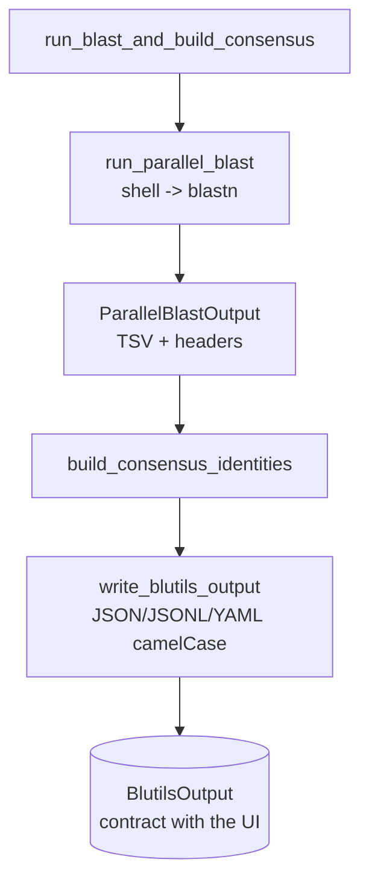
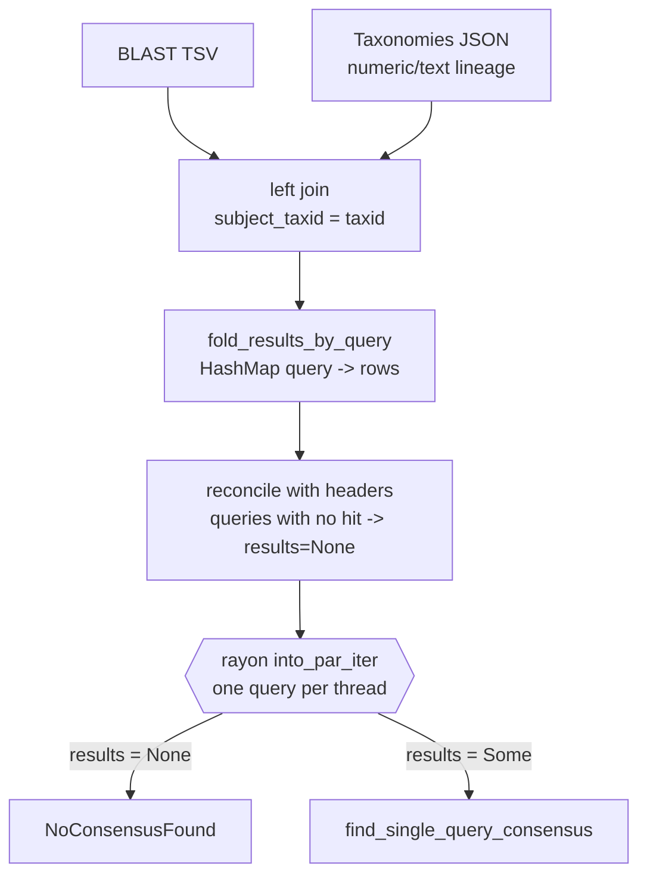
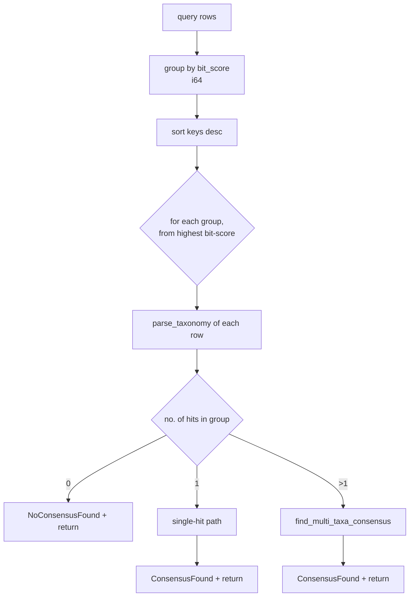
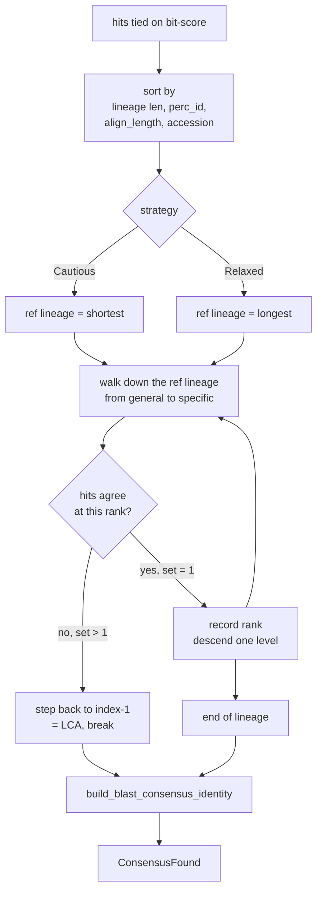
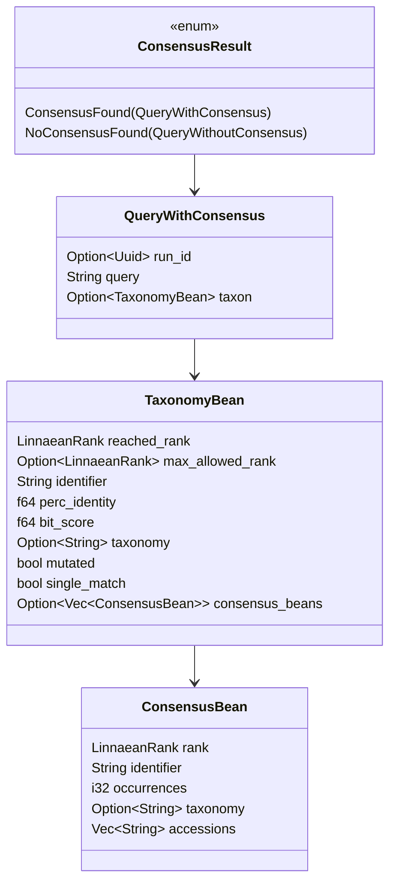

# Design — Structure of the Consensus Classification Algorithm

> *As-built* architecture document for the `blutils` classification core.
> Accompanies `spec.md` in this same directory.
>
> Last updated: 2026-06-22

## 1. Location and boundaries

```
modules/blutils/core/src/
├── use_cases/
│   ├── run_blast_and_build_consensus/      ← orchestration (BLAST + consensus + writing)
│   │   ├── mod.rs
│   │   └── run_parallel_blast.rs
│   └── build_consensus_identities/         ← ALGORITHM CORE
│       ├── mod.rs                          ← loading, join, fold, parallel fan-out
│       ├── find_single_query_consensus.rs  ← bit-score routing
│       ├── find_multi_taxa_consensus.rs    ← consensus/LCA among tied hits
│       ├── build_blast_consensus_identity.rs ← final taxon assembly
│       └── force_parsed_taxonomy.rs        ← helper (Literal → Parsed)
└── domain/dtos/
    ├── linnaean_ranks.rs    ← InterpolatedIdentity (cutoffs + interpolation)
    ├── taxon.rs             ← cutoff backbones per taxon
    ├── consensus_strategy.rs← Cautious | Relaxed
    ├── consensus_result.rs  ← ConsensusResult, ConsensusBean
    ├── taxonomy_bean.rs     ← TaxonomyBean (lineage unit)
    └── blast_result.rs      ← BlastResultRow, parse_taxonomy
```

Classification is **I/O-pure**: it receives a `ParallelBlastOutput` (already materialized
on disk by the process adapter) + the taxonomies file path, and returns
`Vec<ConsensusResult>`. No subprocess call lives here.

## 2. High-level pipeline



## 3. `build_consensus_identities` — loading, joining and fan-out



**Structural points:**

- The join is a **left join** on `subject_taxid`: hits whose taxid is not in the
  taxonomies table survive (with a null `taxonomy`) — the later parse filters them out.
- `fold_results_by_query` iterates the `DataFrame` columns by fixed positional index
  (0..13), building `BlastResultRow` manually. It is **coupled to the column order** of the
  schema — any reordering silently breaks the mapping.
- Reconciliation with `headers` is the only path that guarantees that **every** input query
  appears in the output, even those with no hit.

## 4. `find_single_query_consensus` — bit-score routing



> **Structural note (CONCERN-04):** all three branches return from inside the loop. In practice,
> **only the highest bit-score group is evaluated**; the `for score in sorted_keys` loop never
> reaches the second iteration. The final `NoConsensusFound` fallback at the end of the loop is
> reachable only if `sorted_keys` is empty.

### Single-hit path

1. `force_parsed_taxonomy` ensures an already-parsed lineage.
2. `InterpolatedIdentity::new(taxon, ranks, custom)` builds the cutoffs.
3. `get_adjusted_taxonomy_by_identity(perc_identity, lineage)` **truncates** the lineage at the
   deepest rank justified by the observed identity.
4. The last bean of the adjusted lineage becomes the final taxon, with `single_match = true`.

## 5. `find_multi_taxa_consensus` — consensus and LCA

Applied when there are several hits at the same (best) bit-score — the interesting case.



**LCA (Lowest Common Ancestor) logic:** the reference lineage is walked from the most
general rank (domain) to the most specific (species). At each index, the set of
`rank+identifier` observed among all hits at that level is built:

- **Set of size 1** → all agree; the current rank is accepted and the search descends.
- **Set > 1** → a divergence occurred; the consensus steps back to the last agreeing rank
  (`target_index = index - 1`), aggregates the divergent `consensus_beans` and stops (`break`).

`target_as_single_match` distinguishes the two cases when assembling the final lineage: on the
agreement path (`true`), the lineage is kept whole when there is a single bean; on the
divergence path (`false`), it is truncated at `take_while(index <= bean_index)`.

## 6. `InterpolatedIdentity` — the heart of the rank↔identity adjustment

This is the most sophisticated component and what gives `blutils` its differentiator: translating a
**continuous percent identity** into a **discrete taxonomic rank**.

### 6.1 Cutoff backbone (`taxon.rs`)

Each taxon defines decreasing thresholds per rank. Example (Fungi):

| Rank | Cutoff (%) |
|------|-----------|
| Species | 97 |
| Genus | 95 |
| Family | 90 |
| Order | 85 |
| Class | 80 |
| Phylum | 75 |
| Domain | 60 |

### 6.2 Interpolation of non-Linnaean ranks

`Other` ranks (strain, serovar, etc.) have no cutoff in the backbone. For each window between
two default ranks that surround a sequence of non-default ranks, the cutoff is obtained by
**linear interpolation**:

```
target_identity = first_window_identity
                + (target_index * (window_weight / window_size))

where window_weight = last_window_identity - first_window_identity
```

This allows, for example, assigning an intermediate cutoff between Species (97) and 100% to
a "strain" rank inserted below species.

### 6.3 Query operations

- **`get_rank_adjusted_by_identity(identity)`** → `skip_while(identity > cutoff)` in lineage
  order (increasing cutoffs from general to specific); returns the first rank whose
  cutoff is satisfied → this is the `max_allowed_rank`.
- **`get_adjusted_taxonomy_by_identity(identity, lineage)`** → keeps the beans whose
  `cutoff <= identity`, truncating the lineage at the point justified by the evidence.

### 6.4 Mutation flagging

`build_blast_consensus_identity` truncates the lineage by identity, then sets
`max_allowed_rank` (deepest rank justified by identity, FR-IDENT-03) and `mutated = true` when the
truncation demoted the rank (pre-truncation rank deeper than the final `reached_rank`) —
signaling to the user that the rank was demoted due to lack of identity evidence. Divergence-driven
LCA stops do not set `mutated` (FR-IDENT-05, reworded 2026-11-01; behavior since fixes R02/R21).

## 7. Core data structures



## 8. Structural assessment

Strengths and weaknesses observed in the current structure. Each risk item receives an ID
for future tracking (see also `CONCERNS.md` if/when the brownfield mapping is
generated).

### 8.1 Strengths

- **Clear separation of concerns**: loading/join (`mod.rs`) → routing
  (`find_single`) → consensus (`find_multi`) → assembly (`build_blast_consensus_identity`).
  Each file has a cohesive responsibility.
- **Decoupled identity model** (`InterpolatedIdentity`): the identity→rank translation
  is isolated and testable, and supports non-Linnaean ranks via interpolation.
- **Trivial and safe parallelism**: the per-query fan-out via `rayon` is embarrassingly
  parallel, with no shared mutable state.
- **Determinism**: sorts use explicit tie-breakers (identifier, accession),
  avoiding non-deterministic output under parallelism.

### 8.2 Risks and weaknesses

- **CONCERN-01 (panics instead of errors)** — `find_single_query_consensus`,
  `build_blast_consensus_identity` and `fold_results_by_query` use `panic!`/`unwrap` in
  error paths (e.g.: `panic!("Unexpected error on parse blast results")`,
  `panic!("No taxonomy found for bean at index")`). In a parallel pipeline, a panic takes down
  the thread and potentially the process, with no recoverable error `ConsensusResult`. The layer
  already uses `MappedErrors` — converting these points would be more robust.
- **CONCERN-02 (unverified scientific cutoffs)** — `taxon.rs` carries
  `// TODO: Review the identity percentages and check a reference` in all three backbones
  (Fungi, Bacteria, Eukaryotes). The thresholds directly determine the assigned rank; they are the
  most sensitive scientific parameter of the algorithm and have no cited source.
- **CONCERN-03 (bit-score truncated to i64)** — the TSV reads `bit_score` as `Float64`, but
  `BlastResultRow.bit_score` is `i64` (truncation in the positional extraction). Grouping by
  bit-score (FR-SCORE-01) uses integer equality; hits with close fractional bit-scores
  are grouped or split according to the integer part, which can change which set
  enters the consensus.
- **CONCERN-04 (only the best bit-score is evaluated)** — per the note in §4, the loop
  over `sorted_keys` always returns on the first iteration. If this is intentional (only the
  best tier matters), the loop and the final fallback are misleading dead code; if not, it is
  a tier-descent bug.
- **CONCERN-05 (positional column mapping)** — `fold_results_by_query` maps columns
  by numeric index (`match counter { 0 => query, ... }`). Coupled to the schema order in
  `get_results_dataframe`; a reordering produces no compile error.
- **CONCERN-06 (`as_single_chunk_par` + iterators)** — `fold_results_by_query` collects the
  entire `DataFrame` into memory and iterates row by row outside the polars lazy engine,
  losing part of the benefit of columnar/lazy processing for large tables.

### 8.3 Evolution suggestions (not implemented)

1. Replace `panic!` with `MappedErrors` propagation in the classification paths
   (mitigates CONCERN-01) and map individual query failures to an annotated `NoConsensusFound`
   instead of taking down the thread.
2. Externalize the cutoff backbones to a versioned file/config with source citation
   (mitigates CONCERN-02); the `Custom` path already demonstrates feasibility.
3. Explicitly decide the multi-tier bit-score behavior (CONCERN-04) and remove or
   enable tier descent.
4. Cover the AC-01..AC-05 scenarios of `spec.md` with unit tests, especially the LCA
   (FR-MULTI-05) and identity truncation (FR-IDENT-04).

## 9. Cross-references

- Requirements: `./spec.md`
- Data contract with the UI: `CLAUDE.md` (section "The data contract") and
  `blutils-ui/src/types/BlutilsResult.ts`
- Overall engine architecture: `CLAUDE.md` (section "modules/blutils — Rust engine")
