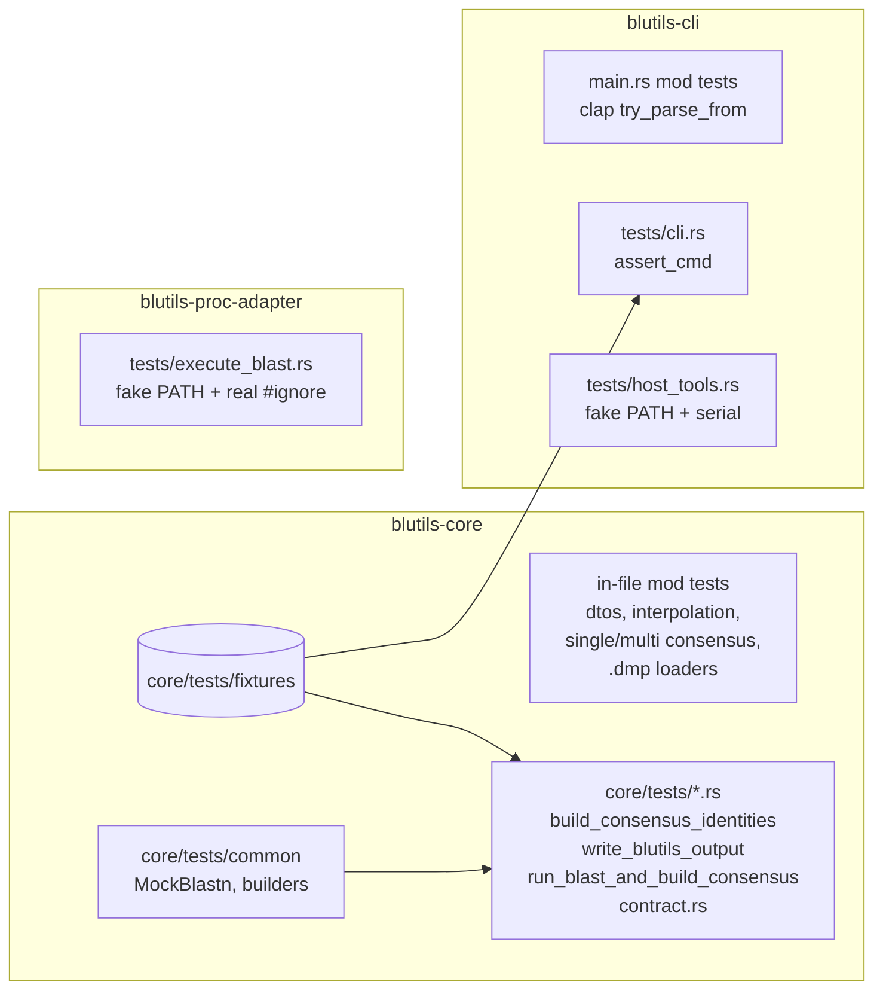

# Test Suite — `modules/blutils` — Design

**Spec**: `spec.md` · **Context**: `context.md` · **Status**: Draft · 2026-11-01

> Paths relative to `modules/blutils/`. Cited lines refer to commit `64bbda8`.
> **[H]** = hypothesis raised by static reading, **to be confirmed by the indicated test**.
> Unmarked items were checked in the code.

---

## 1. Suite architecture

### Support components

| Component | Location | Content |
|---|---|---|
| `MockBlastn` | `core/tests/common/mod.rs` | `impl ExecuteBlastn` (`domain/entities/execute_blastn.rs`) with `Mutex<Vec<String>>` recording payloads; returns canonical `Success(tsv)`, `Fail` or `Err` depending on config |
| builders | `core/tests/common/mod.rs` + `#[cfg(test)] pub(crate) mod test_utils` in `core/src/` | `row(acc, taxid, pident, bitscore, lineage)` → `BlastResultRow` with `Taxonomy::Literal`; `lineage(&["d__a", …])` |
| fake BLAST DB | helper `fake_blast_db(dir)` | creates `db.fna`, empty `db.00.nsq` and empty `taxdb.btd` — `validate_blast_database` only checks existence |
| fixtures | `core/tests/fixtures/` | see §4 |
| executable fakes | `ports/cli/tests/bin/{which,blastn,blastdbcmd}` (shell, `chmod +x` in setup) | echo argv/stdin or print canonical output |

The in-crate `test_utils` is required because `BlastResultRow`, `InterpolatedIdentity` and the finders are
`pub(crate)`/`pub(super)` — unreachable from `core/tests/`.

---

## 2. Bug and discrepancy register (`BUG-R*`)

Policy: `context.md` D-01. Severity: **H** (high) = crashes the process/wrong result; **M** (medium) = incorrect format/data;
**L** (low) = cosmetic/dead code.

| ID | Sev | Location | Description | State |
|---|---|---|---|---|
| R01 | H | `domain/dtos/linnaean_ranks.rs:174-192` | `get_rank_adjusted_by_identity` uses `skip_while(identity > cutoff)` → returns the **first rank with cutoff ≥ identity** (one rank deeper than the satisfied one). Diverges from **FR-IDENT-03**. Zymo fixture confirms (species reached, `maxAllowedRank: subspecies` at 99.355%) | **fixed** (regression: `rank_adjusted_by_identity_returns_deepest_satisfied_rank`) |
| R02 | M | `use_cases/build_consensus_identities/find_single_query_consensus.rs:131-149` | Single path uses `..target_bean`: `mutated` stays `false` and `maxAllowedRank` always `null`. Diverges from **AC-03**. Fixture: 30/30 `singleMatch` with `mutated:false` | **fixed** (regression: `find_single_query_consensus_single_hit_98_marks_mutated`) |
| R03 | H | `…/find_multi_taxa_consensus.rs:181` | `index - 1` with `index == 0` (hits diverge at the domain) → overflow panic (debug) / wrap (release) | **fixed** (regression: `find_multi_taxa_consensus_divergence_at_domain_returns_no_consensus`) |
| R04 | M | `domain/dtos/blast_builder.rs:61-62` | `is_config`/`run_id` without `#[serde(default)]`; fixture `test/mock/output/zymo-mock/blutils.consensus.json` (v7.1.3) does not have them → `json_content::<BlutilsOutput>` fails | **fixed** (regression: `zymo_fixture_deserializes_into_blutils_output`, `blast_builder_deserialize_without_is_config_and_run_id_uses_defaults`) |
| R05 | M | `linnaean_ranks.rs:324-329` | Interpolation window `skip_while(..).take(next_index + 1)` uses an absolute index after the offset → overshoots `next`. E.g.: Bacteria `[d,p,c,subclass,o,f,g,s]` → subclass = 84.25 (expected 82.5) | **fixed** (regression: `interpolate_window_with_offset_is_bounded_by_next_default_rank`) |
| R06 | H | `find_multi_taxa_consensus.rs:41-54,143-145` | `Relaxed`: `take_while(index < len)` over records sorted by ascending length → never descends past the shortest lineage; nullifies **AC-05** | **fixed** (regression: `find_multi_taxa_consensus_relaxed_mixed_depth_returns_genus_lca`) |
| R07 | H | `build_consensus_identities/mod.rs:185` + `find_single_query_consensus.rs:59` | `subject_taxid` missing from the map → taxonomy `"null"` → `parse_taxonomy` errors → panic in `par_iter`; one unknown taxid brings down the run | **fixed** (regression: `build_consensus_identities_unknown_taxid_does_not_abort_other_queries`, `…_unknown_taxid_fixture_returns_no_consensus`, `find_single_query_consensus_unparseable_lineage_returns_no_consensus`) |
| R08 | H | `find_single_query_consensus.rs:115-118` | Identity below all cutoffs → `panic!("No taxonomy found…")`; reachable with `-p 50` | **fixed** (regression: `find_single_query_consensus_identity_below_all_cutoffs_returns_no_consensus`) |
| R09 | M | `use_cases/write_blutils_output.rs:172` + `domain/dtos/file_or_stdin.rs:132-176` | Jsonl with `config=None` writes a `null` line; `json_line_content` cannot read it → `build-consensus --out-format jsonl` ⟶ `build-tabular` breaks. Routing by the substring `"isConfig"` also confuses a query with that name | **fixed** (regression: `json_line_content_null_first_line_reads_as_no_config`, `json_line_content_query_containing_is_config_reads_as_result`, `write_blutils_output_jsonl_without_config_writes_only_results`) |
| R10 | M | `use_cases/parse_consensus_as_tabular/mod.rs:69-159` | File mode does not write `\n` after the header/consensus lines → TSV on a single line; a line without taxon has 2 columns (`{query}\tnull`) against a 12-column header | **fixed** (regression: `parse_consensus_as_tabular_file_mode_writes_one_row_per_line`) |
| R11 | M | `parse_consensus_as_tabular/mod.rs:24-32` | Existence check swaps the extension to `.json` and then reads the original path | **fixed** (regression: `…_existing_yaml_without_json_sibling_is_parsed`, `…_missing_input_with_json_sibling_returns_does_not_exist_error`) |
| R12 | H | `use_cases/build_kraken_db_from_ncbi_files/mod.rs:22-30` | `remove_dir_all` of the output directory **before** validating the database | **fixed** — DB validated before wiping (regression: `build_db_kraken2_missing_database_keeps_output_{directory,file}`) |
| R13 | M | `domain/dtos/consensus_result.rs:65-88` | `fold_consensus_list` duplicates accessions: (a) `dedup()` only removes adjacent items (`[A],[B],[A]` → `[A,B,A]`); (b) the seed entry is cloned with its accessions and then extended with them again (one bean `[A,B]` → `[A,B,A,B]`, `occurrences 1`) | **fixed** (regression: `fold_consensus_list_non_adjacent_repeated_accession_deduplicated`, `fold_consensus_list_multi_accession_first_bean_kept_once`) |
| R14 | M | `build_consensus_identities/mod.rs:184,240` | `bit_score` read as Float64 and extracted as `i64` (CONCERN-03) | **fixed** (regression: `build_consensus_identities_fractional_bit_score_is_preserved`, `find_single_query_consensus_fractional_bit_scores_are_not_truncated`) |
| R15 | M | `build_blutils_db_from_ncbi_files/load_merged_dataframe.rs:60-64` | Nulls filtered per column independently and then `zip` → misaligned pairs | **fixed** (regression: `load_merged_dataframe_row_with_null_is_dropped_as_a_whole`) |
| R16 | M | `…/build_taxonomy_database.rs:449,460` | All ancestors filtered → lineage `";s__x"` (leading `;`) which then fails in `parse_taxonomy` | **fixed** (regression: `build_taxonomy_database_empty_lineage_has_only_leaf`, `…_all_ancestors_filtered_has_only_leaf`) |
| R17 | M | `domain/dtos/taxon.rs:144-184` | No built-in backbone has Kingdom → `k__` becomes an interpolated `NonDefaultRank` (Bacteria `[d,k,p]` → 67.5) | **fixed** (regression: `interpolate_kingdom_built_in_is_default_rank` (built-in Kingdom cutoff = 67.5, midpoint of Domain/Phylum)) |
| R18 | L | `linnaean_ranks.rs:14-29,52-72` | Asymmetry: `FromStr("s")` = `Species`, but deserializing `"s"` = `Other("s")` | **fixed** (regression: `serde_short_name_deserializes_as_default_rank`, `taxonomy_bean_deserialize_short_rank_code_returns_species`) |
| R19 | M | `taxon.rs:28-65` | `CustomTaxon::from_file` does `panic!` on every error; `.yml` rejected | **fixed** (regression: `custom_taxon_from_file_*_returns_err`, `custom_taxon_from_file_yml_extension_loads_values` (`from_file` now returns `Result`)) |
| R20 | L | `ports/cli/src/cmds/blast/mod.rs:30-32` | `set_var("RUST_LOG","none")` has no effect (filter already built) | **fixed** — dead `set_var` removed from `build_consensus_cmd`/`build_tabular_cmd`. `build_consensus_to_stdout_keeps_requested_logs_on_stderr` pins intended behavior but **cannot detect a reversion** (dead code had no observable effect) |
| R21 | M | `…/build_blast_consensus_identity.rs:35-37` | `mutated` is evaluated against the input bean's `reached_rank` **before** identity truncation overwrites it (species bean at 98% → Genus, `maxAllowedRank` Species, `mutated: false`) | **fixed** (regression: `build_blast_consensus_identity_identity_truncation_marks_mutated`) |
| R22 | H | `…/build_blast_consensus_identity.rs` (single-match shortcut) | With `target_as_single_match` and one folded bean, `bean_index` is ignored and the full identity-adjusted lineage is returned — root cause of R06's output | **fixed** (regression: `build_blast_consensus_identity_one_folded_bean_truncates_at_bean_index`) |
| R23 | M | `…/build_blast_consensus_identity.rs` | Identity below every cutoff falls back to `taxonomy[bean_index]`, sets `taxonomy: Some("")`, `maxAllowedRank` Domain, `mutated: true` | **fixed** (regression: `build_blast_consensus_identity_identity_below_all_cutoffs_returns_no_consensus`) |
| R24 | M | `build_consensus_identities/mod.rs:371` | Malformed BLAST TSV (non-numeric column) panics at `finish().unwrap()` instead of returning `Err`; an **empty** TSV returns `Ok` (hypothesis "empty → panic" refuted) | **fixed** (regression: `build_consensus_identities_malformed_blast_file_returns_err`) |
| R25 | L | `…/find_single_query_consensus.rs:68-70` | Dead branch `bit_score_matches.len() == 0` (empty input exits via trailing fallback) | **fixed** (regression: dead branch removed (covered by R07 tests)) |
| R26 | M | `use_cases/shared/write_or_append_to_file.rs:27`, `use_cases/write_blutils_output.rs:201,210` | `write()` return value ignored → a short write silently drops bytes; also the cause of the 3 deny-level `clippy::unused_io_amount` errors | **fixed** (regression: clippy `unused_io_amount` clean) |
| R27 | L | `use_cases/write_blutils_output.rs:95-110` | A `runId` already carried by a `ConsensusFound` result is overwritten by the config/run-wide one | **fixed** (regression: `write_blutils_output_result_run_id_is_kept_over_config_run_id`) |
| R28 | M | `use_cases/shared/validate_blast_database.rs:8-16` | Glob `{stem}*.nsq` accepts a different database sharing the prefix (`db` validates against `dbX.nsq`) | **fixed** (regression: `validate_blast_database_other_database_sharing_prefix_returns_not_found_error`, `…_three_digit_volume_returns_ok`) |
| R29 | M | `domain/dtos/file_or_stdin.rs:82-84` | `Sequence::blast_header` panics on a whitespace-only FASTA header (`split_whitespace().next().unwrap()`) | **fixed** (regression: `sequence_content_whitespace_only_header_returns_error`, `run_blast_and_build_consensus_whitespace_only_header_returns_err`) |
| R30 | M | `…/build_taxonomy_database.rs:426` | `replace_rank` is not applied to the **leaf** rank (`superkingdom__2` leaf while ancestors become `d__`) | **fixed** (regression: `build_taxonomy_database_replace_rank_applies_to_leaf_rank`) |
| R31 | L | `…/build_taxonomy_database.rs:311-313,449` | Merged taxid: numeric leaf uses the old taxid (`s__600`) while text leaf/lineage come from the target — numeric and text lineages disagree (may be intended) | **fixed** — numeric leaf uses the merged target taxid; unit `taxid` keeps the old id so BLAST hits still join (regression: `build_taxonomy_database_merged_with_target_uses_target_taxid_as_numeric_leaf`) |
| R32 | L | `…/build_taxonomy_database.rs:409,464` | Dead code: `.replace("__", "_")` never applies (`slugify!` already removes `__`) | **fixed** (regression: `build_taxonomy_database_double_underscore_in_name_is_slugified`) |
| R33 | M | `use_cases/run_blast_and_build_consensus/run_parallel_blast.rs:63-67` | `create_dir` (non-recursive, error ignored) → missing grandparent of the BLAST output path panics later with "Unable to open file" | **fixed** (regression: `run_blast_and_build_consensus_missing_out_grandparent_is_created`, `…_uncreatable_out_dir_returns_err`) |
| R34 | M | `…/build_blutils_db_from_ncbi_files/load_dump_file.rs:101-106` | Non-strict cast silently nulls bad numeric values in every `.dmp` loader (unreachable `panic!` branch); rows dropped without warning — root cause of R15 | **fixed** — one `warn!` per file/column with count, target type and first raw values; cast errors return `Err` (regression: `load_dump_file_non_numeric_integer_value_warns_with_file_column_and_count`, `load_dump_file_clean_file_emits_no_warning`) |
| R35 | M | `use_cases/run_blast_and_build_consensus/run_parallel_blast.rs:84` | `std::process::exit(1)` skips dropping the non-blocking log appender guard (`ports/cli/src/main.rs:40`) → the only error message ("Could not overwrite existing file…") is lost intermittently; user sees exit 1 with empty stderr | **fixed** — `process::exit(1)` replaced by `Err` (also `remove_file` panic) (regression: `run_blast_and_build_consensus_existing_out_without_overwrite_returns_err`, `run_with_consensus_existing_out_file_without_force_reports_error`) |
| R36 | L | `use_cases/shared/write_or_append_to_file.rs:20` | `build-db qiime2` does not create the output parent directory → panics "Unable to open file" | **fixed** — qiime2 creates output parent dirs (regression: `build_db_qiime2_missing_output_parent_directory_is_created`) |
| R37 | L | `domain/dtos/taxon.rs:90-102` | `Taxon::from_str` short aliases (`b`/`f`/`e`/`c`) are unreachable from the CLI (clap uses the `ValueEnum` derive) | **fixed** — `#[value(alias = …)]` on `Taxon` variants (regression: `taxon_accepts_short_aliases`) |
| R38 | H | `domain/dtos/linnaean_ranks.rs` `interpolate_identities` | A non-default rank before the first default rank (NCBI `cellular root` since 2025, `no rank` nodes) took `backbone[0]` as cutoff — species (99/97) for the built-in backbones, domain for custom ones. A lineage made of one non-default rank got a `NaN` cutoff (0/0 window). Found by the end-to-end zymo run (`e2e/`, 2026-11-01): 651/2283 results (exactly those below 99% identity) lost the `cellular-root__` prefix, so one taxon had two `taxonomy` strings | **fixed** — leading non-default ranks take the next default rank's cutoff (shallowest backbone cutoff when the lineage has none); a zero-width window keeps the first identity (regression: `interpolate_leading_non_default_rank_gets_the_domain_cutoff`, `interpolate_several_leading_non_default_ranks_get_the_domain_cutoff`, `interpolate_single_non_default_rank_gets_the_shallowest_cutoff`, `adjusted_taxonomy_with_leading_non_default_rank_keeps_the_root`, `build_consensus_identities_leading_non_linnaean_rank_is_kept_below_species_cutoff`) |
| R39 | M | `domain/dtos/linnaean_ranks.rs` `get_adjusted_taxonomy_by_identity` | Identity truncation was a `filter`: a rank with an unmet cutoff was removed while deeper ranks with lower cutoffs were kept, so the lineage was not a contiguous prefix (R38 symptom; also custom backbones with unset ranks → cutoff 0) | **fixed** — `take_while` (regression: `adjusted_taxonomy_non_monotonic_custom_truncates_at_first_unmet_cutoff`, `adjusted_taxonomy_keeps_prefix_up_to_first_unmet_cutoff`) |
| R40 | H | `use_cases/run_blast_and_build_consensus/run_parallel_blast.rs` | `--threads N` was not a ceiling: chunks were dispatched with `par_bridge` and each `pool.install` call (pool of N) ran one `blastn -num_threads N`, so up to N concurrent `blastn` × N threads ≈ N² (measured: `--threads 5` → 4 concurrent `blastn`, 40 OS threads) | **fixed** — chunks run on a pool of `min(N, chunks)` threads and each `blastn` gets `N / concurrency` threads; `limit_threads(N)` also caps the global rayon pool (consensus, taxdump loaders) and Polars (`POLARS_MAX_THREADS`, unless set) for the whole process. Measured: `--threads 5` → 5 `blastn` threads in total; `build-consensus --threads 3` peaks at 8 OS threads (was 22) (regression: `run_blast_and_build_consensus_threads_is_a_ceiling_across_parallel_chunks`, `run_blast_and_build_consensus_runs_chunks_in_parallel_up_to_threads`, `run_blast_and_build_consensus_single_chunk_gets_every_thread`, `limit_threads_caps_the_global_rayon_and_polars_pools`) |
| R41 | L | `docs/book/01_create_blutils_database.md`, `ports/cli/src/cmds/db_builder/commands.rs` | Docs and `--replace-rank` help recommend `superkingdom=d`; NCBI taxdumps since 2025 have no `superkingdom` (Bacteria are `domain`, plus new `kingdom` and `cellular root` ranks), so the option has no effect; sample lineages outdated | **fixed** — docs note on the 2025 changes, help text and sample lineages updated (docs only) |
| R42 | M | `ports/cli/src/{main.rs,cmds/**}` | Every CLI error (missing BLAST+, custom taxon without cutoffs, invalid `--replace-rank`, invalid `--log-level`, use-case errors) exited via `panic!` (code 101, Rust panic banner, raw `unwrap` messages) | **fixed** — commands return `anyhow::Result`; `main` prints `Error: <message>` and exits with code 1 (regression: `ports/cli/tests/{cli,host_tools}.rs` assert code 1, an informative message and no `panicked` in stderr, e.g. `invalid_log_level_fails_before_running_the_command`, `check_linux_with_blastdbcmd_missing_fails_with_missing_dependencies`) |
| R43 | H | `core/src/**` (46 `panic!`, input-reachable `unwrap`/`expect`) | Input- and I/O-reachable failures panicked instead of returning `Err`: `blastn` failures inside the worker pool, unopenable/unwritable output files, malformed `blastdbcmd` lines, malformed or empty `.dmp` files, tax_ids above `i32::MAX`, database paths without a name, custom taxon without values, unparsed lineages, cast errors | **fixed** — all converted to `Err` with context (path, line, chunk); shared `write_or_append_to_file`/`append`/`remove_if_exists`/`write_or_stdout` return `Result` (regression: `run_blast_and_build_consensus_blast_fail_returns_err_with_blastn_message`, `run_blast_and_build_consensus_blast_error_returns_err_with_cause`, `write_or_append_to_file_nonexistent_parent_returns_err_with_path`, `write_or_stdout_file_branch_writer_error_returns_err`, `load_dump_file_line_with_fewer_fields_than_columns_returns_err`, `load_dump_file_empty_file_returns_empty_dataframe`, `build_taxonomy_database_tax_id_above_i32_max_is_accepted`, `validate_blast_database_path_without_name_returns_err`, `get_taxon_cutoff_custom_without_values_returns_err`, `find_multi_taxa_consensus_literal_taxonomy_returns_err`, `build_blast_consensus_identity_bean_index_out_of_range_returns_err`, `write_blutils_output_subject_reads_without_file_name_is_kept_verbatim`) |

**Discrepancies with the as-built spec (D-03):** R01 ↔ FR-IDENT-03, R02 ↔ AC-03, R06/R22 ↔ AC-05 (all confirmed by test). Also: multi-path LCA `percIdentity` is the **reference record's** identity (lowest under Cautious), not the max — the max is only used for rank adjustment.

---

> **Note (2026-11-01, DF-04):** YAML is handled by `serde_yaml_ng` (replaced the deprecated `serde_yaml`).

## 3. Case catalog per file

Location legend: **IF** = in-file `mod tests`; **IT** = `core/tests/`; **CLI** = `ports/cli/tests/`.

### 3.1 `core/src/domain/utils/mod.rs` — IF
- `round(84.2549, 3) == 84.255`; `round(1.0/3.0, 3) == 0.333`; `round(NaN, 3).is_nan()`.

### 3.2 `core/src/domain/dtos/linnaean_ranks.rs` — IF (priority 1)
- **FromStr**: `d|domain|u|k|p|c|o|f|g|s` (case/whitespace-insensitive, `" Species "`); others → `Other(slug)` (`"Species Group"` → `Other("species-group")`, `"no rank"` → `Other("no-rank")`). Never `Err`.
- **Display** (`Species`→`"s"`, `Other("strain")`→`"strain"`) vs `as_full_rank_string` (`"species"`); round-trip `FromStr(Display(x)) == x` for all variants.
- **Serde**: `Species`↔`"species"`, `Other("strain")`↔`"strain"`; `"s"` → `Other("s")` (R18); `"Species"` → `Other("Species")` [H].
- **`interpolate_identities`** (via `InterpolatedIdentity::new`):
  - default ranks only, Bacteria `[d,p,c,o,f,g,s]` → `[60,75,80,85,92,97,99]`; Fungi/Eukaryotes `[60,75,80,85,90,95,97]` (FR-IDENT-01).
  - empty taxonomy → `Ok([])`.
  - intermediate non-default rank: `[…,g,species-group,s]` → 98.0 (FR-IDENT-02) [H].
  - R05 window: `[d,p,c,subclass,o,f,g,s]` → characterization 84.25 + desired 82.5 `#[ignore]`.
  - final non-default rank `[…,s,strain]` → 100.0.
  - initial non-default rank `[clade,d,…]`: built-in uses backbone[0]=Species, Custom uses Domain → different values [H].
  - single non-default rank `[strain]` → `NaN` [H].
  - duplicated non-default names `[d,clade,p,clade,c]` → each gets its own window: `[60, 67.5, 75, 77.5, 80]` (hypothesis "first occurrence wins" refuted by test).
  - two trailing non-default ranks `[…,s,subspecies,strain]` → `[99.5, 100.0]` (linear from s to 100).
  - Kingdom R17.
- **`get_rank_adjusted_by_identity`** (Bacteria): 98→`Species`, 99→`Species`, 99.5→`None`, 50→`d:60` (R01 characterization) + desired FR-IDENT-03 test `#[ignore]`.
- **`get_adjusted_taxonomy_by_identity`** (FR-IDENT-04): 98 → keeps d..g (6); 100 → all; 59 → `[]`; non-monotonic Custom (genus `None`→0) keeps g and discards d [H]; `zip` truncates when lengths differ.
- `Display` of `InterpolatedIdentity` → `"d:60,p:75,…"`.

### 3.3 `core/src/domain/dtos/taxon.rs` — IF
- Per-taxon cutoff table (pins the values marked `TODO: review`, CONCERN-02).
- Custom `{domain:60, species:99}` → `[D60,K0,P0,C0,O0,F0,G0,S99]`, order Domain→Species.
- `get_taxon_cutoff(Custom, None)` → `#[should_panic]`.
- `Taxon::from_str`: `"b"`, `"Bacteria"`, `"bacteria"` → Bacteria; `"BACTERIA"` → `Err(())`.
- `CustomTaxon::from_file` (tempdir): YAML ok, JSON ok, no extension/`.yml`/nonexistent/invalid YAML/invalid JSON → `#[should_panic]` each (R19); `97.5` and missing `species` rejected [H].
- `Taxon` serde: `bacteria|fungi|eukaryotes|custom`.

### 3.4 `core/src/domain/dtos/blast_builder.rs` — IF
- `BlastBuilder::default("db", Bacteria)`: `is_config=true`, `blutils_version=CARGO_PKG_VERSION`, `out_format` = 13-field string, `max_target_seqs 10`, `perc_identity 80`, `query_cov 80`, `strand Both`, `e_value 0.001`, `word_size 15`; `run_id` distinct between calls.
- each `with_*` changes only its own field. `Strand` Display `both|plus|minus`.

### 3.5 `core/src/domain/dtos/blast_result.rs` — IF
- `parse_taxonomy("d__2;p__1224;…;s__93973")` → 7 beans; ranks; raw `identifier`; `perc_identity`/`bit_score as f64` copied; other fields default.
- `"species-group__x"` → `Other("species-group")`.
- `Err` for `""`, `"null"`, `"d__2;"`, `"s__a__b"`, `";d__2"`.
- already `Parsed` → unchanged clone; `self` is also mutated.

### 3.6 `core/src/domain/dtos/taxonomy_bean.rs` — IF
- `taxonomy_to_string`: `Species`+`x` → `"s__x"`; `Other("strain")` → `"strain__x"`.
- `taxonomy_beans_to_string([])` → `""`; round-trip with `parse_taxonomy` for short ranks.

### 3.7 `core/src/domain/dtos/consensus_result.rs` — IF
- `from_taxonomy_bean`: `occurrences 0`, `accessions [acc]`/`[]`, `taxonomy Some`.
- `fold_consensus_list` (FR-BEAN-01): 3× `g__x` → `occurrences 3`; empty → `[]`; taxonomy of the first one wins; R13 (`[A,B,A]`). **Sort before comparing.**

### 3.8 `core/src/domain/dtos/file_or_stdin.rs` — IT (tempdir)
- `sequence_content`: multi-line multi-FASTA concatenates; empty lines ignored; `>` removed throughout the header; CRLF is stripped by `BufRead::lines` (hypothesis "preserves `\r`" refuted by test); sequence before header → `Err` only when the next `>` is found; file with sequence only → `Ok([])`; header with empty sequence kept in the middle, discarded at EOF (inconsistency); nonexistent → `Err(StdIn(NotFound))`; `test/mock/input/query/query.fna` → 10 records.
- `blast_header`: `"NR1.2 desc"` → `"NR1.2"`; empty → panic.
- `json_content::<BlutilsOutput>`: valid ok; invalid → `FromStr("unable to parse content as JSON…")`; zymo fixture → R04 error.
- `json_line_content`: line with `isConfig` → config; others → result; first line `null` → error (R09).
- `yaml_content`: round-trip of `write_blutils_output(Yaml)` [H].
- `Source::from_str("-")`: **a single test in a dedicated binary** (`core/tests/stdin_source.rs`): first call `Stdin`, second `Err(StdInRepeatedUse)`.

### 3.9 Other DTOs — IF
- `BlutilsOutput::default()` → `{"results":[],"config":null}`.
- `ConsensusStrategy` serde `"Cautious"/"Relaxed"` (no `rename_all`).
- `TaxonomiesMap` camelCase round-trip.
- `ExecutionResponse` serde `{"Success":…}`.

### 3.10 `core/src/use_cases/write_blutils_output.rs` — IT
- forced extension (`out.txt` + Json → `out.json`); existing file removed; parent directories created.
- `NoConsensusFound` → `{query, taxon:null, runId}`; `runId` equal in all = `config.run_id` (or new UUID without config).
- results sorted by `query`; `subjectReads` reduced to the file name; `subject_reads` `""`/`"/"`/`".."` → panic.
- Json → read back as `BlutilsOutput`; Jsonl → first line config or `null` (R09); Yaml → read back [H].
- stdout branch (`None`) only via CLI.

### 3.11 `core/src/use_cases/build_consensus_identities/` (core)

**Units (IF in `mod.rs`, reaches `pub(super)`):**

| Case | Input | Expected | Trace |
|---|---|---|---|
| best bit-score group | rows bit 500 (1) + 400 (3) | uses only the 500 hit → single path | FR-SCORE-01/02, CONCERN-04 |
| empty group | direct call `find_single_query_consensus(q, vec![], …)` (zero iterations → fallback) | `NoConsensusFound` | FR-SCORE-03 |
| single 100% | Bacteria `d..s`, pident 100 | `ConsensusFound`, `reachedRank species`, `singleMatch true`, 1 bean `occ 1` | AC-02, FR-SINGLE-* |
| single 98% | same, 98 | truncated at genus; `mutated false`, `maxAllowedRank null` (R02) + desired AC-03 `#[ignore]`; bean with **full** taxonomy | AC-03 |
| single below everything | pident 55 | `#[should_panic(expected="No taxonomy found")]` | R08 |
| multi all agree | 3 hits same species | species, 1 bean `occ 3`, accessions `[a,b,c]` | FR-MULTI-04 |
| multi LCA | 2 hits equal up to f, diverge at g | taxon = family; beans = 2 genera sorted occ desc, id asc; `percIdentity` = max | AC-04, FR-MULTI-05, FR-BEAN-02 |
| divergence at the domain | 2 hits with different `d` | `#[should_panic]` (overflow in debug) + desired `NoConsensusFound` `#[ignore]` | R03 |
| Cautious vs Relaxed | A (len 5), B and C (len 7, agree up to 4, diverge at 6) | characterization: Relaxed stops at index 4 (R06) + desired AC-05 `#[ignore]` | AC-05, FR-MULTI-01..03 |
| record sorting | tie in length | tie-break by `perc_identity`, `align_length`, `subject_accession` | FR-MULTI-01 |
| empty records | `[]` | `NoConsensusFound` | — |
| delegation to `build_blast_consensus_identity` | any multi | taxon assembled by it | FR-MULTI-06 |
| `Taxonomy::Literal` in multi | — | panic via `force_parsed_taxonomy` | — |
| `NaN` in pident | — | `#[should_panic]` | — |
| `build_blast_consensus_identity` | `bean_index >= len` | `#[should_panic]` | — |
| `build_blast_consensus_identity` | empty beans | `consensus_beans` remains `None` | FR-BEAN-02 |
| `mutated` | rank `None` (identity > all cutoffs) | keeps the input value | FR-IDENT-05 |

**Integration (IT, `build_consensus_identities` is `pub`):**
- `use_taxid Some(true)` → `numeric_lineage`; `None`/`Some(false)` → `text_lineage` (FR-IN-05, FR-JOIN-02).
- nonexistent taxonomies → `Err("Taxonomies file not found")`; invalid JSON → `Err`.
- nonexistent blast TSV → `Err`; empty/malformed → panic [H].
- headers `["q1","q2"]`, TSV with q1 only → q2 `NoConsensusFound` (AC-01, FR-NOHIT-01); `headers None` → no reconciliation; query with `results None` → `NoConsensusFound` (FR-NOHIT-02); left join preserves rows (FR-JOIN-03); grouping by query (FR-JOIN-04).
- unknown taxid → panic (R07) + desired `#[ignore]`.
- `bit_score` 845.9 → 845 (R14).
- quotes in query name removed (`mod.rs:169`) [H].
- **results sorted by query before comparing.**

### 3.12 `core/src/use_cases/run_blast_and_build_consensus/` — IT with `MockBlastn`
- no `.nsq` → `Err("Blast database not found")`; no `taxdb.btd` → `Err("Taxdb not found")`.
- `.out` extension forced; `overwrite=true` removes; `overwrite=false` with existing file → `process::exit(1)` (**only via CLI**, see 3.17).
- 120 sequences → 3 calls to the mock totaling 120 records (chunks of 50).
- `Success(tsv)` concatenated into the `.out`; `headers` = first token, input order.
- mock `Fail` → panic; mock `Err` → panic.
- end to end: mock + `TaxonomiesMap` + `blutils_out_file` → expected JSON.

### 3.13 `core/src/use_cases/shared/` — IF (tempdir)
- `validate_blast_database`: `dir/db.fna` matches `db.00.nsq` and also `dbX.nsq` (loose prefix) [H]; `~` expanded; `taxdb.btd` must be in the same dir; `"/"`/`".."` → panic.
- `write_or_append_to_file`: two writes concatenate; nonexistent parent → panic.
- `write_or_stdout` (file branch): no additional `\n`.

### 3.14 `core/src/use_cases/parse_consensus_as_tabular/` — IT
- R10 characterization (a single line; line without taxon with 2 columns) and R11; consensus line with 12 columns and `run-id` resolved (result → config → UUID); blast match line with `perc null` and `bit` from the parent bean; accessions joined with `", "`; `.tsv` forced; existing file removed.

### 3.15 `core/src/use_cases/build_blutils_db_from_ncbi_files/` — IF (tempdir + polars)
- `load_dump_file`: split `|` + trim; nonexistent → `Err`; short line → panic; empty → panic [H].
- `load_del_nodes_dataframe`: `"1\t|\n2\t|\n"` → `[1,2]`.
- `load_merged_dataframe`: `"10\t|\t20\t|\n"` → `{10:20}`; R15.
- `load_names_dataframe`: only `scientific name`.
- `load_lineage_dataframe`/`load_nodes_dataframe`: schema and dtypes.
- **`build_taxonomy_database`** (no subprocess — receives `accessions_map`): each missing `.dmp` → specific `Err`; outputs `out.blutils.json` + `out.non-mapped.tsv`; delnodes → `deleted`; merged without target → `merged`; missing → `unknown`; merged with target → unit with the **old taxid** and new lineage; `numeric_lineage`/`text_lineage` (slug, `__` → `_`); `replace_rank {"superkingdom":"d"}`; `drop_non_linnaean_taxonomies` removes `clade`/`no rank` and discards units with a non-Linnaean leaf; `ignore_taxids`; R16; empty name → `taxid-{id}`; tax_id > `i32::MAX` → panic. **Sort `taxonomies` before comparing.**

### 3.16 Use cases with subprocess and no seam — CLI `host_tools.rs` (`#[serial]`)
- `check_host_requirements`: both on PATH → Ok; one missing → `Err("Missing dependencies…")`; no `which` → `Err("Unexpected error…")`.
- `build_qiime_db_from_blutils_db`: TSV half testable without `.nsq` (writes `.tsv` before validating): `"Feature ID\tTaxon\n"` + `"{taxid}-{oid}-{acc}\t{lineage}"`; `blastdbcmd` half with fake; line < 4 fields → panic.
- `build_kraken_db_from_ncbi_files`: R12 (directory with sentinel deleted even with database missing); `generate_taxonomies_file` fs only (IF): `.txt` forced, `"TAXID\tkraken:taxid|{t}|{h}\t{t}\n"`, empty → empty file; `generate_fasta_file` with fake: uppercase, wrap at 80 columns, header `>kraken:taxid|{taxid}|{acc}`.
- `build_accessions_map` with fake: non-integer taxid → panic; < 3 fields → panic.

### 3.17 `ports/cli` 
- **Rule (static `STDIN_HAS_BEEN_USED`)**: every `try_parse_from` passes an **explicit query path** (the `query` positional has default `"-"`, which goes through `FileOrStdin::from_str` and sets the static, breaking subsequent parses in an order-dependent way). The "default = stdin" assertion goes to `tests/cli.rs` (own process). [H] `command().debug_assert()` may evaluate defaults → isolate in its own binary (`ports/cli/tests/clap_debug_assert.rs`) if confirmed.
- **Parsing (IF in `main.rs`)**: `CliLauncher::<Opts>::command().debug_assert()`; required args of `run-with-consensus` (`--taxon`, `--strategy`, `-d`, `-t`, `--blast-out-file`); `--out-format` default `json`; `--threads` default `Some(1)`; value sets of `Taxon|Strategy|OutputFormat|Strand|LogFormat`; `--taxon b` rejected [H]; `-u`/`-f` → true; `build-db blu -d` absent → `Some(false)` [H]; `-s 131567 -s 2`; `-r superkingdom=d`; global `-t` (threads) vs subcommand `-t` (tax_file).
- **Process (`tests/cli.rs`)**: `blu blastn build-consensus <tsv> -t <tax.json> --taxon bacteria --strategy cautious` → valid JSON on stdout; `--taxon custom` without `-c` → exit 101 + "Custom taxon values are required"; `build-tabular x.json -o out` → `out.tsv`; `--log-level "[[bad"` → panic; `--log-file` receives `.log`/`.jsonl`.
- **Fake PATH (`tests/host_tools.rs`)**: `blu check linux`; `run-with-consensus` with existing `.out` without `-f` → exit 1.

### 3.18 `adapters/proc` — `adapters/proc/tests/execute_blast.rs`
- fake `blastn` that echoes argv: `-db`, `-outfmt "<fmt>"`, `-max_target_seqs`, `-perc_identity`, `-qcov_hsp_perc`, `-strand`, `-evalue 0.001`, `-word_size`, `-num_threads`; exit 0 → `Success(stdout)`; ≠0 → `Fail(stderr)`; no binary → `Err`. `#[serial]`.
- real `#[ignore]`: `makeblastdb` over `test/mock/input/ref_databases/mock-16S.fna` + `query.fna`.

---

## 4. Fixtures (`core/tests/fixtures/`)

| File | Content | Used by |
|---|---|---|
| `blast/basic.tsv` | 13 columns, ~10 rows: q1 single 100%, q2 single 98%, q3 agreeing multi, q4 multi LCA genus | 3.11, 3.12, CLI |
| `blast/unknown_taxid.tsv` | q5 with taxid missing from the map | 3.11 (R07) |
| `contract/{blast.tsv,taxonomies.blutils.json,headers.txt}` | **golden-only** (`004-tests-data-contract`): single 100% with `…;s__x;strain__y` (rank `Other`, cutoff 100), multi with LCA (non-null `maxAllowedRank`), query only in headers (`taxon: null`) — isolated so that changes to unit fixtures do not alter the golden | contract.rs |
| `taxonomies/basic.blutils.json` | `TaxonomiesMap` with 6–8 taxids, consistent `numeric_lineage` and `text_lineage` | 3.11, CLI |
| `custom_taxon/{valid.yaml,valid.json,invalid.yaml}` | `CustomTaxon` | 3.3 |
| `fasta/{multi.fna,no_header.fna,crlf.fna}` | edge-case FASTA | 3.8 |
| `taxdump/{names,nodes,taxidlineage,delnodes,merged}.dmp` | tree of ~10 nodes with 1 deleted, 1 merged, 1 clade, 1 superkingdom | 3.15 |

Existing `test/mock/`: `query.fna` and `mock-16S.fna` are reused; `mock-16S_taxonomies.tsv`
(QIIME format) and `zymo-mock/data.tsv` (SRA metadata) do **not** serve the consensus; the zymo fixture
serves only R04 and the contract.

---

## 5. Design decisions

- **In-file vs `tests/`**: governed by visibility, not by preference (see TESTING.md).
- **No `rstest`/`insta` in the first batch**: tables with a simple `for` are enough; snapshots would require redacting `runId`/`blutilsVersion` and sorting. Re-evaluate after the foundation.
- **`serial_test`** only in the cli/proc crate (PATH); core does not change environment variables.
