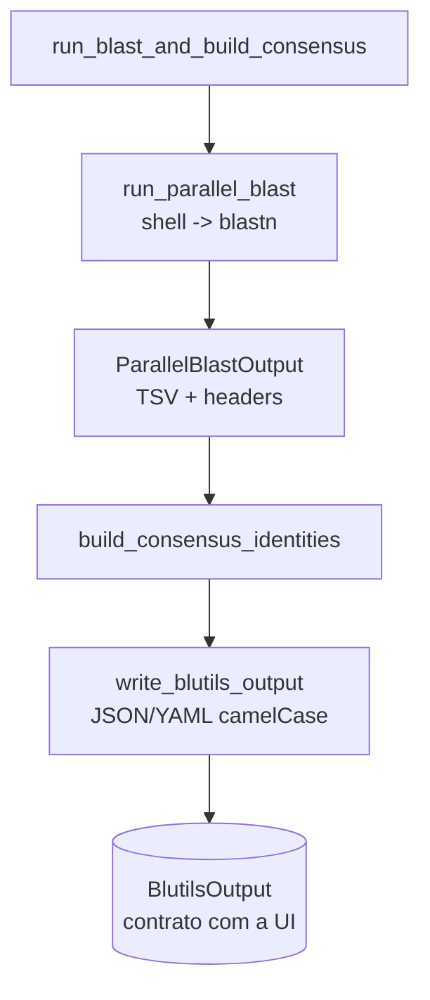
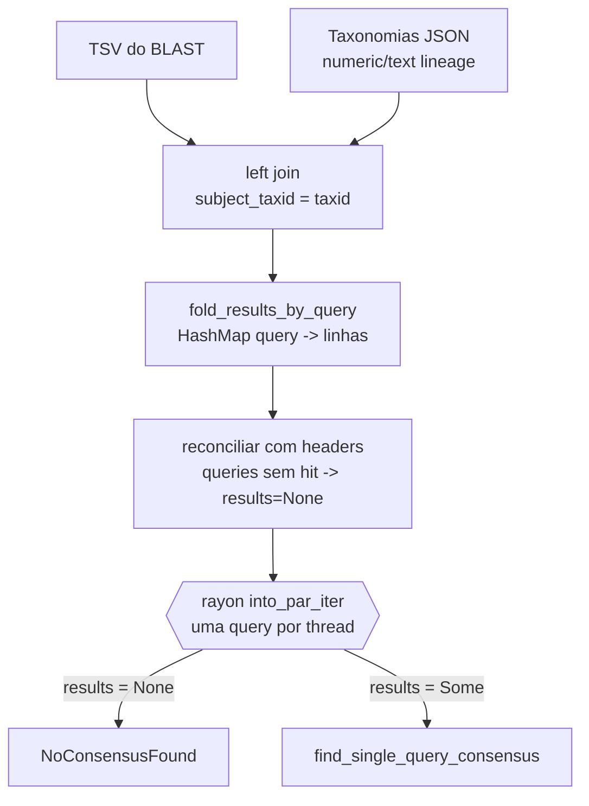
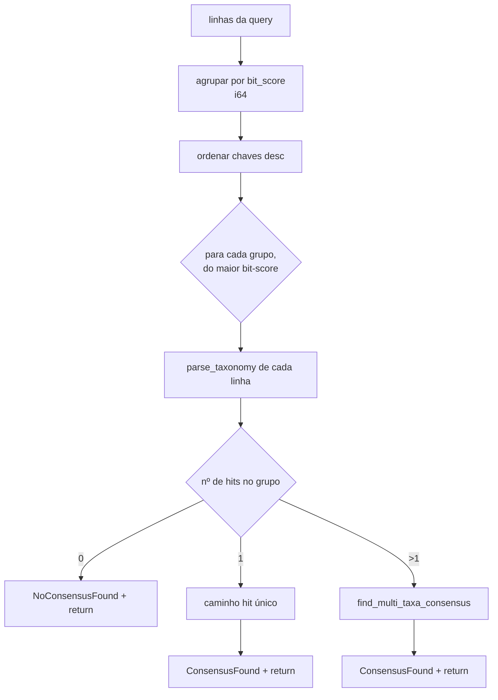
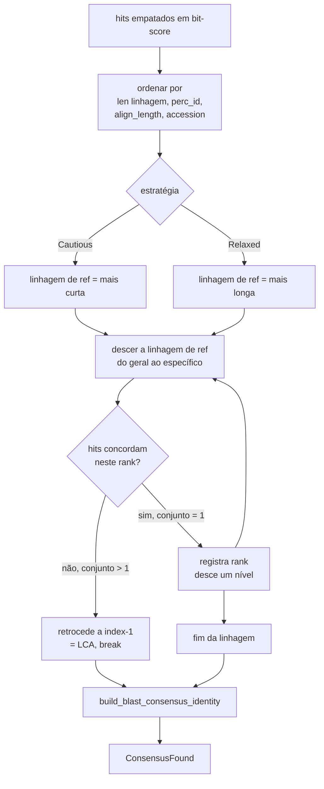
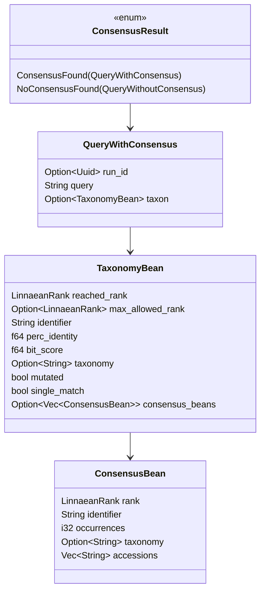

# Design — Estrutura do Algoritmo de Classificação por Consenso

> Documento de arquitetura *as-built* do núcleo de classificação do `blutils`.
> Acompanha `spec.md` neste mesmo diretório.
>
> Última atualização: 2026-06-22

## 1. Localização e fronteiras

```
modules/blutils/core/src/
├── use_cases/
│   ├── run_blast_and_build_consensus/      ← orquestração (BLAST + consenso + escrita)
│   │   ├── mod.rs
│   │   └── run_parallel_blast.rs
│   └── build_consensus_identities/         ← NÚCLEO DO ALGORITMO
│       ├── mod.rs                          ← carga, join, fold, fan-out paralelo
│       ├── find_single_query_consensus.rs  ← roteamento por bit-score
│       ├── find_multi_taxa_consensus.rs    ← consenso/LCA entre hits empatados
│       ├── build_blast_consensus_identity.rs ← montagem do táxon final
│       └── force_parsed_taxonomy.rs        ← helper (Literal → Parsed)
└── domain/dtos/
    ├── linnaean_ranks.rs    ← InterpolatedIdentity (cutoffs + interpolação)
    ├── taxon.rs             ← backbones de cutoff por táxon
    ├── consensus_strategy.rs← Cautious | Relaxed
    ├── consensus_result.rs  ← ConsensusResult, ConsensusBean
    ├── taxonomy_bean.rs     ← TaxonomyBean (unidade de linhagem)
    └── blast_result.rs      ← BlastResultRow, parse_taxonomy
```

A classificação é **pura quanto a I/O**: recebe um `ParallelBlastOutput` (já materializado
em disco pelo adapter de processo) + caminho do arquivo de taxonomias, e devolve
`Vec<ConsensusResult>`. Nenhuma chamada de subprocesso vive aqui.

## 2. Pipeline de alto nível



## 3. `build_consensus_identities` — carga, junção e fan-out



**Pontos estruturais:**

- A junção é **left join** sobre `subject_taxid`: hits cujo taxid não está na tabela de
  taxonomias sobrevivem (com `taxonomy` nula) — o parse posterior os filtra.
- `fold_results_by_query` itera as colunas do `DataFrame` por índice posicional fixo
  (0..13), montando `BlastResultRow` manualmente. É **acoplado à ordem das colunas** do
  schema — qualquer reordenação quebra o mapeamento silenciosamente.
- A reconciliação com `headers` é o único caminho que garante que **toda** query de entrada
  apareça na saída, mesmo as sem hit.

## 4. `find_single_query_consensus` — roteamento por bit-score



> **Nota estrutural (CONCERN-04):** os três ramos retornam de dentro do laço. Na prática,
> **apenas o grupo de maior bit-score é avaliado**; o laço `for score in sorted_keys` nunca
> chega à segunda iteração. O fallback final `NoConsensusFound` ao fim do laço é
> alcançável apenas se `sorted_keys` estiver vazio.

### Caminho de hit único

1. `force_parsed_taxonomy` garante linhagem já parseada.
2. `InterpolatedIdentity::new(taxon, ranks, custom)` constrói os cutoffs.
3. `get_adjusted_taxonomy_by_identity(perc_identity, lineage)` **trunca** a linhagem no rank
   mais profundo justificado pela identidade observada.
4. O último bean da linhagem ajustada vira o táxon final, com `single_match = true`.

## 5. `find_multi_taxa_consensus` — consenso e LCA

Aplicado quando há vários hits no mesmo (melhor) bit-score — o caso interessante.



**Lógica de LCA (Lowest Common Ancestor):** a linhagem de referência é percorrida do rank
mais geral (domain) ao mais específico (species). Em cada índice, monta-se o conjunto
`rank+identifier` observado entre todos os hits daquele nível:

- **Conjunto de tamanho 1** → todos concordam; o rank corrente é aceito e a busca desce.
- **Conjunto > 1** → houve divergência; o consenso retrocede ao último rank concordante
  (`target_index = index - 1`), agrega os `consensus_beans` divergentes e encerra (`break`).

O `target_as_single_match` distingue os dois casos ao montar a linhagem final: no caminho
de concordância (`true`), a linhagem é mantida inteira quando há um único bean; no caminho
de divergência (`false`), é truncada em `take_while(index <= bean_index)`.

## 6. `InterpolatedIdentity` — o cerne do ajuste rank↔identidade

Este é o componente mais sofisticado e o que dá ao `blutils` seu diferencial: traduzir uma
**identidade percentual contínua** num **rank taxonômico discreto**.

### 6.1 Backbone de cutoffs (`taxon.rs`)

Cada táxon define limiares decrescentes por rank. Exemplo (Fungi):

| Rank | Cutoff (%) |
|------|-----------|
| Species | 97 |
| Genus | 95 |
| Family | 90 |
| Order | 85 |
| Class | 80 |
| Phylum | 75 |
| Domain | 60 |

### 6.2 Interpolação de ranks não-Lineanos

Ranks `Other` (strain, serovar, etc.) não têm cutoff no backbone. Para cada janela entre
dois ranks default que cercam uma sequência de ranks não-default, o cutoff é obtido por
**interpolação linear**:

```
target_identity = first_window_identity
                + (target_index * (window_weight / window_size))

onde window_weight = last_window_identity - first_window_identity
```

Isso permite, por exemplo, atribuir um cutoff intermediário entre Species (97) e 100% para
um rank de "strain" inserido abaixo de espécie.

### 6.3 Operações de consulta

- **`get_rank_adjusted_by_identity(identity)`** → `skip_while(identity > cutoff)` na ordem
  da linhagem (cutoffs crescentes do geral ao específico); retorna o primeiro rank cujo
  cutoff é satisfeito → este é o `max_allowed_rank`.
- **`get_adjusted_taxonomy_by_identity(identity, lineage)`** → mantém os beans cujo
  `cutoff <= identity`, truncando a linhagem no ponto justificado pela evidência.

### 6.4 Marcação de mutação

`build_blast_consensus_identity` compara `reached_rank` (rank anotado na referência) com
`max_allowed_rank` (rank justificado pela identidade). Se diferem, `mutated = true` —
sinalizando ao usuário que o rank foi rebaixado por falta de evidência de identidade.

## 7. Estruturas de dados centrais



## 8. Avaliação estrutural

Pontos fortes e fragilidades observados na estrutura atual. Cada item de risco recebe um ID
para rastreamento futuro (ver também `CONCERNS.md` se/quando o mapeamento brownfield for
gerado).

### 8.1 Pontos fortes

- **Separação de responsabilidades clara**: carga/join (`mod.rs`) → roteamento
  (`find_single`) → consenso (`find_multi`) → montagem (`build_blast_consensus_identity`).
  Cada arquivo tem uma responsabilidade coesa.
- **Modelo de identidade desacoplado** (`InterpolatedIdentity`): a tradução
  identidade→rank é isolada e testável, e suporta ranks não-Lineanos via interpolação.
- **Paralelismo trivial e seguro**: o fan-out por query via `rayon` é embaraçosamente
  paralelo, sem estado compartilhado mutável.
- **Determinismo**: ordenações usam desempates explícitos (identifier, accession),
  evitando saída não-determinística sob paralelismo.

### 8.2 Riscos e fragilidades

- **CONCERN-01 (panics em vez de erros)** — `find_single_query_consensus`,
  `build_blast_consensus_identity` e `fold_results_by_query` usam `panic!`/`unwrap` em
  caminhos de erro (ex.: `panic!("Unexpected error on parse blast results")`,
  `panic!("No taxonomy found for bean at index")`). Num pipeline paralelo, um panic derruba
  a thread e potencialmente o processo, sem `ConsensusResult` de erro recuperável. A camada
  já usa `MappedErrors` — converter esses pontos seria mais robusto.
- **CONCERN-02 (cutoffs científicos não verificados)** — `taxon.rs` carrega
  `// TODO: Review the identity percentages and check a reference` nos três backbones
  (Fungi, Bacteria, Eukaryotes). Os limiares determinam diretamente o rank atribuído; são o
  parâmetro científico mais sensível do algoritmo e estão sem fonte citada.
- **CONCERN-03 (bit-score truncado para i64)** — o TSV lê `bit_score` como `Float64`, mas
  `BlastResultRow.bit_score` é `i64` (truncamento na extração posicional). O agrupamento por
  bit-score (FR-SCORE-01) usa igualdade inteira; hits com bit-scores fracionários próximos
  são agrupados ou separados conforme a parte inteira, o que pode alterar qual conjunto
  entra no consenso.
- **CONCERN-04 (apenas o melhor bit-score é avaliado)** — conforme a nota em §4, o laço
  sobre `sorted_keys` sempre retorna na primeira iteração. Se isso for intencional (só o
  melhor tier importa), o laço e o fallback final são código morto enganoso; se não for, é
  um bug de descida de tier.
- **CONCERN-05 (mapeamento posicional de colunas)** — `fold_results_by_query` mapeia colunas
  por índice numérico (`match counter { 0 => query, ... }`). Acoplado à ordem do schema em
  `get_results_dataframe`; uma reordenação não gera erro de compilação.
- **CONCERN-06 (`as_single_chunk_par` + iteradores)** — `fold_results_by_query` coleta o
  `DataFrame` inteiro em memória e itera linha a linha fora do motor lazy do polars,
  perdendo parte do benefício do processamento colunar/lazy para tabelas grandes.

### 8.3 Sugestões de evolução (não implementadas)

1. Substituir `panic!` por propagação de `MappedErrors` nos caminhos de classificação
   (mitiga CONCERN-01) e mapear falhas de query individual para um `NoConsensusFound`
   anotado em vez de derrubar a thread.
2. Externalizar os backbones de cutoff para arquivo/config versionado com citação de fonte
   (mitiga CONCERN-02); o caminho `Custom` já demonstra a viabilidade.
3. Decidir explicitamente o comportamento multi-tier de bit-score (CONCERN-04) e remover ou
   ativar a descida de tier.
4. Cobrir com testes unitários os cenários AC-01..AC-05 do `spec.md`, em especial o LCA
   (FR-MULTI-05) e o truncamento por identidade (FR-IDENT-04).

## 9. Referências cruzadas

- Requisitos: `./spec.md`
- Contrato de dados com a UI: `CLAUDE.md` (seção "The data contract") e
  `blutils-ui/src/types/BlutilsResult.ts`
- Arquitetura geral do engine: `CLAUDE.md` (seção "modules/blutils — Rust engine")
